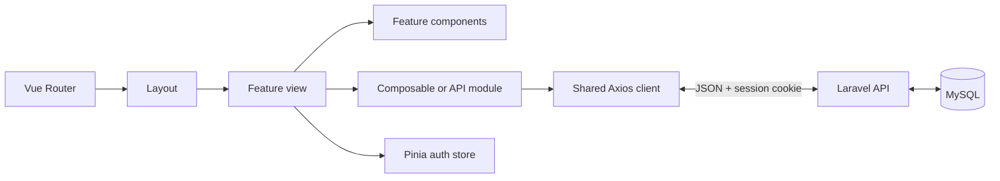
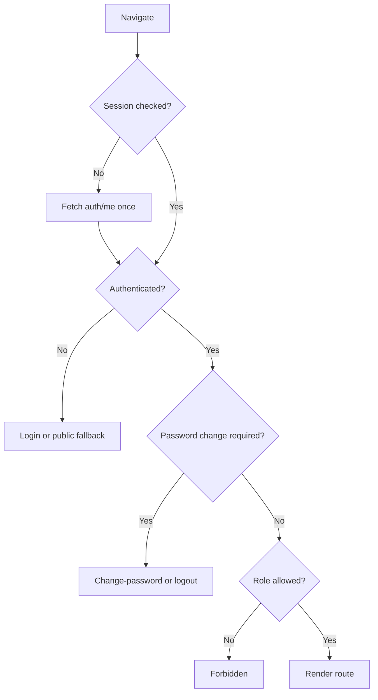
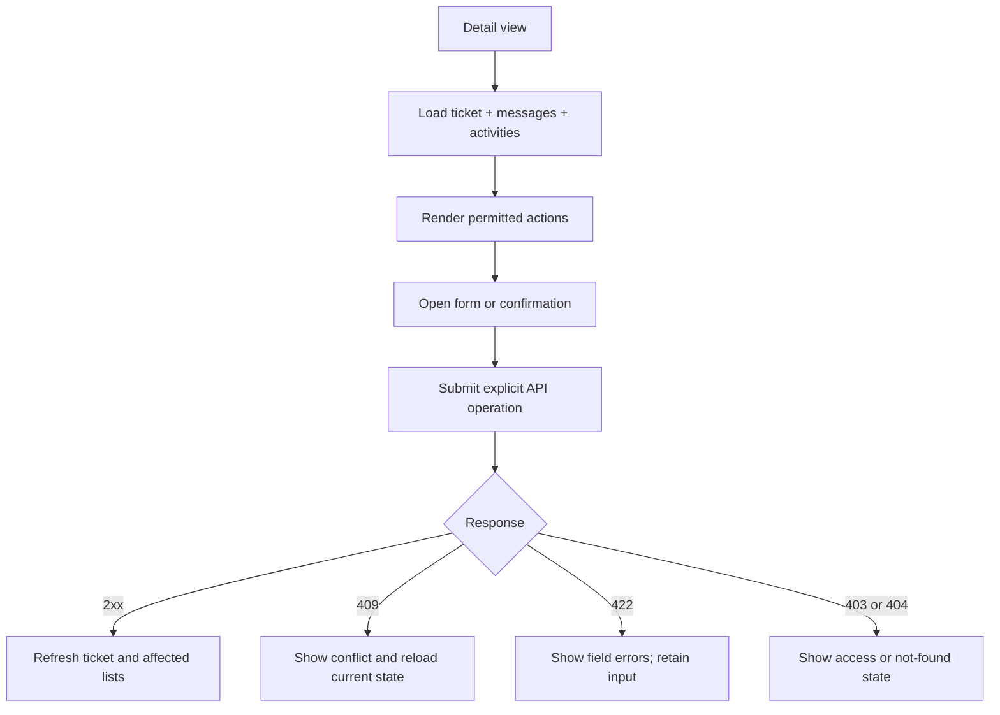

# ResolveDesk | Vue 3 Frontend Architecture

**Reference:** v0.9 proposed system baseline · Frontend implementation guide  
**Stack:** Vue 3, Vite, Vue Router, Pinia, Axios, Buefy (Vue 3 compatible) with Bulma  
**Backend:** Laravel REST API + Sanctum stateful session authentication; MySQL  
**Approach:** Feature-based organization with a small shared UI and infrastructure layer.

> This is a folder and implementation reference, not generated application code. Create files as their features are implemented. The system specification remains the authority for business rules and API contracts; this guide does not add backend features.

## 1. Architecture decision

Use **feature-based folders**, not a single giant `components/`, `views/` or `services/` directory. Keep each business module's views, components and API functions together. Share only genuinely reusable code.



Vue owns presentation, navigation, loading/error states and form interaction. Laravel owns authentication, authorization, validation, business rules and persistence. Vue never accesses MySQL directly.

## 2. Recommended folder structure

The following is the target structure for the first release, **not a list of files to scaffold on day one**. JavaScript is used to keep the frontend simple while you focus on Laravel. TypeScript can be adopted later without changing the overall structure.

```text
resolvedesk
└── frontend/                            # Vue 3 + Vite application
    ├── public/
    ├── src/
    │   ├── main.js                      # Register router, Pinia and Buefy
    │   ├── App.vue                      # Root RouterView
    │   │
    │   ├── assets/
    │   │   ├── images/                  # Logo and static illustrations
    │   │   └── styles/
    │   │       └── main.css             # Global theme overrides
    │   │
    │   ├── router/
    │   │   ├── index.js                 # Route definitions
    │   │   └── guards.js                # Session, role, password-change guards
    │   │
    │   ├── layouts/
    │   │   ├── AuthLayout.vue           # Login and forced password change
    │   │   └── AppLayout.vue            # Signed-in navigation + RouterView
    │   │
    │   ├── services/
    │   │   ├── http.js                  # One Axios instance; cookies and CSRF
    │   │   └── apiErrors.js             # Interpret common API errors
    │   │
    │   ├── components/                  # Shared UI only
    │   │   ├── navigation/
    │   │   │   ├── AppSidebar.vue
    │   │   │   └── AppHeader.vue
    │   │   └── ui/
    │   │       ├── PageHeader.vue
    │   │       ├── LoadingState.vue
    │   │       ├── EmptyState.vue
    │   │       ├── ErrorState.vue
    │   │       ├── FieldError.vue
    │   │       ├── ConfirmDialog.vue
    │   │       └── AppPagination.vue
    │   │
    │   ├── composables/                 # Reusable stateful logic
    │   │   └── usePaginatedList.js       # Optional once list patterns repeat
    │   ├── utils/
    │   │   └── formatDate.js            # UTC ISO string -> local display
    │   ├── constants/
    │   │   └── roles.js                 # requester, agent, admin
    │   │
    │   ├── features/
    │   │   ├── auth/
    │   │   │   ├── api/authApi.js
    │   │   │   ├── stores/authStore.js   # Current user + session bootstrap
    │   │   │   └── views/
    │   │   │       ├── LoginView.vue
    │   │   │       ├── ChangePasswordView.vue
    │   │   │       └── AccountView.vue
    │   │   │
    │   │   ├── tickets/
    │   │   │   ├── api/ticketApi.js
    │   │   │   ├── constants/ticketOptions.js
    │   │   │   ├── utils/ticketPermissions.js
    │   │   │   ├── composables/
    │   │   │   │   ├── useTicketList.js
    │   │   │   │   └── useTicketDetail.js
    │   │   │   ├── views/
    │   │   │   │   ├── TicketListView.vue
    │   │   │   │   ├── TicketCreateView.vue
    │   │   │   │   └── TicketDetailView.vue
    │   │   │   └── components/
    │   │   │       ├── TicketTable.vue
    │   │   │       ├── TicketFilters.vue
    │   │   │       ├── TicketForm.vue
    │   │   │       ├── TicketSummary.vue
    │   │   │       ├── TicketStatusBadge.vue
    │   │   │       ├── TicketPriorityBadge.vue
    │   │   │       ├── TicketActions.vue
    │   │   │       ├── TicketMessageList.vue
    │   │   │       ├── TicketMessageForm.vue
    │   │   │       ├── TicketActivityList.vue
    │   │   │       └── dialogs/
    │   │   │           ├── AssignTicketDialog.vue
    │   │   │           ├── ChangePriorityDialog.vue
    │   │   │           ├── WaitForRequesterDialog.vue
    │   │   │           ├── ResolveTicketDialog.vue
    │   │   │           └── ReopenTicketDialog.vue
    │   │   │
    │   │   ├── users/
    │   │   │   ├── api/userApi.js
    │   │   │   ├── views/
    │   │   │   │   ├── UserListView.vue
    │   │   │   │   └── UserCreateView.vue
    │   │   │   └── components/
    │   │   │       ├── UserTable.vue
    │   │   │       ├── UserFilters.vue
    │   │   │       ├── UserForm.vue
    │   │   │       ├── EditUserDialog.vue
    │   │   │       └── ResetPasswordDialog.vue
    │   │   │
    │   │   ├── categories/
    │   │   │   ├── api/categoryApi.js
    │   │   │   ├── views/CategoryListView.vue
    │   │   │   └── components/
    │   │   │       ├── CategoryTable.vue
    │   │   │       └── CategoryFormDialog.vue
    │   │   │
    │   │   ├── notifications/
    │   │   │   ├── api/notificationApi.js
    │   │   │   ├── views/NotificationListView.vue
    │   │   │   └── components/NotificationList.vue
    │   │   │
    │   │   └── reports/
    │   │       ├── api/reportApi.js
    │   │       ├── views/ReportSummaryView.vue
    │   │       └── components/
    │   │           ├── TicketCountCards.vue
    │   │           ├── StatusBreakdown.vue
    │   │           ├── PriorityBreakdown.vue
    │   │           └── AgentWorkloadTable.vue
    │   │
    │   └── views/                      # App-wide fallback pages only
    │       ├── ForbiddenView.vue
    │       └── NotFoundView.vue
    ├── tests/                          # Add when frontend tests begin
    │   ├── unit/
    │   └── e2e/
    ├── .env.example
    ├── .gitignore
    ├── index.html
    ├── package.json
    ├── vite.config.js
    └── README.md
```

Messages and activities belong to `tickets/`, because they cannot exist as independent resources in the approved API. A generic confirmation dialog can handle claim, start, resume, close, activation/deactivation and clearing assignment; do not create a separate page for each operation.

## 3. Where to put code

| Location | Responsibility | Example |
|---|---|---|
| `features/*/views/` | Route-level screen; load data and coordinate actions | Ticket detail screen |
| `features/*/components/` | UI specific to a feature; props and emitted events | Ticket status badge |
| `features/*/api/` | Functions for the feature's HTTP endpoints | `resolveTicket(id, resolution)` |
| `features/*/composables/` | Stateful Vue logic shared across that feature | Ticket detail refresh |
| `features/auth/stores/` | Shared current session/user state | `authStore.js` |
| `components/ui/` | Business-independent shared UI | Empty state, pagination |
| `services/` | Shared HTTP infrastructure only | Axios client, error parsing |
| `router/` | Routes and navigation checks | Admin-only reports |
| `layouts/` | Shared page shells, menus and navigation | Signed-in layout |
| `utils/` | Pure reusable functions | Format UTC timestamps |
| `constants/` | Shared fixed values | User roles |

Do not create a repository layer, event bus, generic CRUD engine or global store for every model. These add complexity without a requirement.

### Naming conventions

- Vue components and views: `PascalCase.vue`, route views end in `View`.
- JavaScript modules: `camelCase.js`, composables begin with `use`.
- Folders: lowercase; feature names plural except `auth`.
- API JSON fields: retain `snake_case` from Laravel (e.g. `assigned_to`). JavaScript local names/functions can use camelCase.
- Use the `@/` alias for `src/` if configured in Vite; otherwise use relative imports. Keep one convention.

## 4. Navigation and route plan

All authenticated routes require an active session and completed password change unless explicitly exempt. All three roles share one application layout; the menu changes by role. Do not duplicate the same ticket screens into separate admin/agent/requester folders.

| Vue route | View | Access |
|---|---|---|
| `/` | Redirect | Signed-out → `/login`; forced change → `/change-password`; eligible admin → `/reports`; other users → `/tickets` |
| `/login` | LoginView | Guest |
| `/change-password` | ChangePasswordView | Authenticated, including forced-change sessions |
| `/account` | AccountView | Eligible authenticated user; own details only |
| `/tickets` | TicketListView | All eligible roles; requester sees own, support sees all |
| `/tickets/new` | TicketCreateView | Requester only |
| `/tickets/:id` | TicketDetailView | Own requester or support; Laravel decides visibility |
| `/reports` | ReportSummaryView | Admin only |
| `/users` | UserListView | Admin only |
| `/users/new` | UserCreateView | Admin only |
| `/categories` | CategoryListView | Admin only |
| `/notifications` | NotificationListView | All eligible roles |
| `/403` | ForbiddenView | Fallback |
| `/:pathMatch(.*)*` | NotFoundView | Fallback |

The UI PDF proposes `/users/:id`, but the backend contract does not provide `GET /users/{id}`. **This guide recommends editing the selected user in a dialog on `/users`** using the record from the paginated list. Refresh the list after mutations. A standalone deep-linkable detail view needs an approved read endpoint or another explicit retrieval contract. Do not invent one.

### Sidebar menu

| Requester | Agent | Administrator |
|---|---|---|
| My tickets | Support queue | Reports |
| New ticket | My assigned tickets (filter) | All tickets |
| Notifications | Notifications | Users |
| Account | Account | Categories |
| | | Notifications / Account |

“My assigned tickets” uses `/tickets?assigned_to=<current-user-id>` with the same view, not another module. No requester or agent analytics dashboard is required. The sidebar can link to logout; logout is a POST operation, not a read route.

### Route guard behavior



Use route meta such as `requiresAuth` and `roles`. The auth store needs an initialization flag to distinguish unknown session from logged out. A network failure during bootstrap is not proof of logout; show a recoverable error. Prevent redirect loops for `/login`, `/change-password` and fallback pages. Never treat route guards as server-side authorization.

## 5. API module map

All paths below are relative to `/api/v1`, except the Sanctum CSRF endpoint. These are the approved endpoints from the system PDF, pp. 19–23. Keep the HTTP calls in feature API modules rather than components.

| File | Functions and endpoints |
|---|---|
| `authApi.js` | `csrfCookie`: GET `/sanctum/csrf-cookie` (root); `login`: POST `/auth/login`; `logout`: POST `/auth/logout`; `me`: GET `/auth/me`; `changePassword`: POST `/auth/change-password` |
| `userApi.js` | `listUsers`: GET `/users`; `createUser`: POST `/users`; `updateUser`: PATCH `/users/{id}`; `setUserActive`: PATCH `/users/{id}/active`; `resetPassword`: POST `/users/{id}/reset-password` |
| `categoryApi.js` | `listCategories`: GET `/categories`; `createCategory`: POST `/categories`; `updateCategory`: PATCH `/categories/{id}`; `setCategoryActive`: PATCH `/categories/{id}/active` |
| `ticketApi.js` | `listTickets`: GET `/tickets`; `createTicket`: POST `/tickets`; `getTicket`: GET `/tickets/{id}`; explicit workflow and child-resource functions below |
| `notificationApi.js` | `listNotifications`: GET `/notifications`; `markRead`: PATCH `/notifications/{uuid}/read` |
| `reportApi.js` | `getSummary`: GET `/reports/summary` |

### Ticket API actions

| Function | Method / path | Body |
|---|---|---|
| `assignTicket(id, assignedTo)` | POST `/tickets/{id}/assign` | `{ assigned_to: assignedTo }` (string or explicit null) |
| `claimTicket(id)` | POST `/tickets/{id}/claim` | None |
| `changePriority(id, priority)` | PATCH `/tickets/{id}/priority` | `{ priority }` |
| `startTicket(id)` | POST `/tickets/{id}/start` | None |
| `waitForRequester(id, body)` | POST `/tickets/{id}/wait` | `{ body }` |
| `resumeTicket(id)` | POST `/tickets/{id}/resume` | None |
| `resolveTicket(id, resolution)` | POST `/tickets/{id}/resolve` | `{ resolution }` |
| `reopenTicket(id, reason)` | POST `/tickets/{id}/reopen` | `{ reason }` |
| `closeTicket(id)` | POST `/tickets/{id}/close` | None |
| `listMessages(id, params)` | GET `/tickets/{id}/messages` | Query params |
| `createMessage(id, payload)` | POST `/tickets/{id}/messages` | `{ body, visibility }` |
| `listActivities(id, params)` | GET `/tickets/{id}/activities` | Query params |

There is **no** generic ticket update or deletion endpoint. The requester creation payload is `{ subject, description, category_id }`; assignment, status, priority and requester ID are server-controlled at creation.

## 6. API setup and reusable pattern

The example assumes separate Vite and Laravel dev servers on the same hostname (`localhost`), with Laravel configured for credentialed CORS, stateful Sanctum and the frontend origin. Set your real origins in production; prefer a same-origin reverse proxy where practical. Do not mix `localhost` and `127.0.0.1` for session/CSRF testing.

`.env.example` (public frontend configuration only):

```dotenv
VITE_API_ORIGIN=http://localhost:8000
```

`src/services/http.js`:

```js
import axios from 'axios'

export const http = axios.create({
  baseURL: import.meta.env.VITE_API_ORIGIN,
  withCredentials: true,
  withXSRFToken: true,
  headers: { Accept: 'application/json' },
})
```

The base URL is the Laravel **origin**, not `/api/v1`, because `/sanctum/csrf-cookie` lives outside the API prefix. Do not put database credentials or secret API keys in any `VITE_` variable. Laravel must authorize the configured origin and allow credentials; cookie settings must match the deployment domains and HTTPS configuration.

`src/features/tickets/api/ticketApi.js` (minimal illustration):

```js
import { http } from '@/services/http'

const base = '/api/v1/tickets'

export async function listTickets(params = {}) {
  const response = await http.get(base, { params })
  return response.data // { data: Ticket[], meta: {...} }
}

export async function getTicket(id) {
  const response = await http.get(`${base}/${id}`)
  return response.data.data // Ticket
}

export async function createTicket(payload) {
  const response = await http.post(base, payload)
  return response.data.data
}
```

Use the same response-unwrapping convention throughout: single resources return the resource, paginated calls return `{ data, meta }`, 204 actions return nothing. Do not mix these patterns between modules. Report summary is an object, not a paginated list.

`src/features/auth/api/authApi.js` (login pattern):

```js
import { http } from '@/services/http'

export async function login(credentials) {
  await http.get('/sanctum/csrf-cookie')
  const response = await http.post('/api/v1/auth/login', credentials)
  return response.data.data
}
```

Register Pinia, Vue Router and Buefy in `main.js`, and load the Buefy-provided CSS and then custom `main.css`. Use Buefy's bundled Bulma styles; avoid importing another conflicting Bulma version. Tailwind is an alternative styling choice, not a requirement to install alongside Buefy. Verify the installed package's documented CSS import path when setting up the project.

## 7. Ticket feature implementation rules

One detail view handles all roles and states. `TicketActions.vue` receives the current ticket and user, and `ticketPermissions.js` calculates which buttons to show. Laravel still decides whether every mutation succeeds.

R = own requester, S = currently assigned agent, A = admin.

| Action | Open | In progress | Waiting for requester | Resolved | Closed |
|---|---|---|---|---|---|
| Assign/reassign | A | A | A | A | — |
| Clear assignment | A | — | — | — | — |
| Claim | Agent, unassigned | — | — | — | — |
| Start | S/A, assigned | — | — | — | — |
| Request information | — | S/A | — | — | — |
| Resume | — | — | S/A | — | — |
| Change priority | S/A | S/A | S/A | — | — |
| Public reply | R/S/A | R/S/A | R/S/A | — | — |
| Internal note | S/A | S/A | S/A | — | — |
| Resolve | — | S/A | — | — | — |
| Reopen | — | — | — | R/S/A | — |
| Close | — | — | — | R/A | — |

Start/wait/resume/resolve require an active assignee even for admins. A public requester reply while waiting automatically resumes work on the backend. All authorized support users may read messages/activities, but only assigned agents/admins can write where permitted. Requesters receive public-only messages and activities from the API, not private data filtered out in Vue. Admins select assignees from the existing `/users` API with `role=agent` and `is_active=true` (paginate when needed); agents do not call the admin-only users endpoint.



After mutations, use fresh server data instead of manually inventing ticket state. In particular, posting a message returns a Message, not the updated Ticket; refresh the ticket to reflect possible status changes. Disable duplicate submissions while pending. Clear sensitive private content and cached detail state when the session changes.

## 8. State management and forms

Use Pinia for the authenticated user and session initialization. Keep page-specific data in `ref()`/`computed()` or a feature composable: ticket lists, filters, selected tickets, form drafts and loading flags. Use the URL query as the source of truth for list filters when navigation/bookmarking matters. There is no need for a global `ticketStore` in the first release.

For list requests:

- Read `data` and `meta` (`page`, `per_page`, `total`, `last_page`) from the backend; do not paginate a server-paginated array again.
- Ticket filters: `status`, `priority`, `category_id`, `assigned_to` (ID or `unassigned`), `q`, `sort` (`created_at` or `-created_at`), `page`, `per_page`.
- Remove unused filters from the query instead of sending empty/unknown keys. Reset to page 1 when filters change. Debounce search and cancel or ignore stale responses.
- Keep IDs as strings, including route parameters and select values; do not use `Number(id)` or `.number` on ID controls. Notification IDs are UUID strings.
- Use the exact statuses `open`, `in_progress`, `waiting_for_requester`, `resolved`, `closed`; priorities `low`, `medium`, `high`, `urgent`. Map these to human-friendly labels only at display time.

A form component receives initial values and field errors as props, and emits submit/cancel events. The parent view owns the API call. Send only fields allowed by the contract. User/category status toggles send actual JSON booleans; query booleans use `true`/`false` strings. Keep passwords untrimmed and never persist them. Render ticket text with Vue interpolation, not `v-html`. Laravel remains the authority for validation; password length is specified in bytes, not simply JavaScript character count.

## 9. Error and authentication handling

Use a small shared error normalizer that reads Laravel's `{ message, code, errors? }`. Keep feature-specific handling in the view/composable; avoid a single interceptor that redirects for every failure.

| Status | Expected frontend behavior |
|---|---|
| 401 | Clear session state; go to login for protected views |
| 403 `PASSWORD_CHANGE_REQUIRED` | Go to password-change view; keep eligible auth operations available |
| Other 403 | Show forbidden or action error; do not log the user out |
| 404 | Not found/unavailable; never reveal hidden resource information |
| 409 | Explain conflict; reload current record and permitted actions |
| 419 | Refresh CSRF once; retry only a known CSRF-rejected operation when safe |
| 422 | Show field errors beside inputs, or generic invalid credentials message |
| 429 | Show throttling message; respect Retry-After when available |
| 500 / 503 | Show a generic recoverable error; no stack trace or SQL details |
| Network failure | Distinguish from a server response; do not blindly repeat mutations with unknown outcome |

Do not store bearer tokens in localStorage: the chosen architecture uses Sanctum session cookies. Logout clears frontend state after a successful logout or confirmed invalid session. Handle login 409 (already authenticated) by checking the current session. Inactive/reset accounts may lose their session, so recover on the next protected API request.

## 10. Suggested build order

| Step | Implement | Completion criterion |
|---|---|---|
| 1 | Vite, Vue, Buefy, Axios, router, Pinia | App boots and can reach Laravel |
| 2 | HTTP client, auth API/store, guards, layouts | Login, refresh session, logout, required password change |
| 3 | Shared loading, error and pagination components | Consistent list/form states |
| 4 | Category picker, requester ticket list/create/detail | Requester can create and view own tickets |
| 5 | Admin user and category management | Approved list/create/update/activation/reset operations |
| 6 | Agent queue and admin assignment, claim, start | Correct role/state actions and conflict handling |
| 7 | Ticket messages, notes, activities, remaining transitions | Full workflow, private content protected |
| 8 | Notifications and admin report summary | Only specified notification/report features |
| 9 | End-to-end role testing and UI polish | All approved workflows verified with Laravel |

You can develop static layout components early, but integrate a feature only when its Laravel contract is implemented and tested. Avoid using mock behavior as a substitute for authorization or persistence.

## 11. Frontend acceptance checklist

- [ ] Session survives refresh through `/auth/me`; logout and forced password change work.
- [ ] Requester cannot reach another requester's ticket even with a direct URL.
- [ ] Agents can read all tickets but cannot modify tickets assigned to someone else, except an allowed unassigned claim.
- [ ] Closed tickets are read-only and resolved tickets expose only permitted mutations.
- [ ] A simultaneous claim or stale workflow conflict shows a recoverable message and updated state.
- [ ] Requester message and activity responses contain no internal content.
- [ ] Pagination, filters, validation errors, empty and loading states work.
- [ ] Admin can manage users/categories and view only the specified summary metrics.
- [ ] No unsupported registration, attachment, live chat, SLA, generic ticket deletion or profile-edit operation is exposed.
- [ ] IDs remain strings and timestamps display local time while retaining UTC API values.
- [ ] Keyboard navigation, form labels, dialog focus, and text labels for status badges are usable.

## 12. Source references and design decisions

- `ResolveDesk_System_Analysis_and_Developer_Handoff.pdf` v0.9: pp. 7–9 (business rules, role matrix and lifecycle), pp. 17–18 (architecture/security), pp. 19–23 (exact API contracts), pp. 24–25 (tests).
- `ResolveDesk_UI_Reference.pdf`: pp. 2–38 (screens), p. 39 (error states), p. 40 (action matrix), p. 41 (route map and self-profile update discrepancy).
- The feature-based folders, one signed-in layout, JS instead of TypeScript, and dialog-based user editing are proposed frontend decisions, not requirements from those documents. The `/users/:id` route is intentionally omitted pending an individual-user read contract. Self-profile name/email editing is also omitted because there is no API endpoint for it; users can view their own account and change passwords.
- The structure and examples were checked against the supplied PDFs. This guide is not a scaffold or a running Vue application; no frontend code was executed.

**Keep this file at `docs/frontend-architecture.md`.** Create modules progressively. The main goal is to know exactly where a new file belongs and what responsibility it should have, while keeping most of your learning effort on the Laravel backend.
